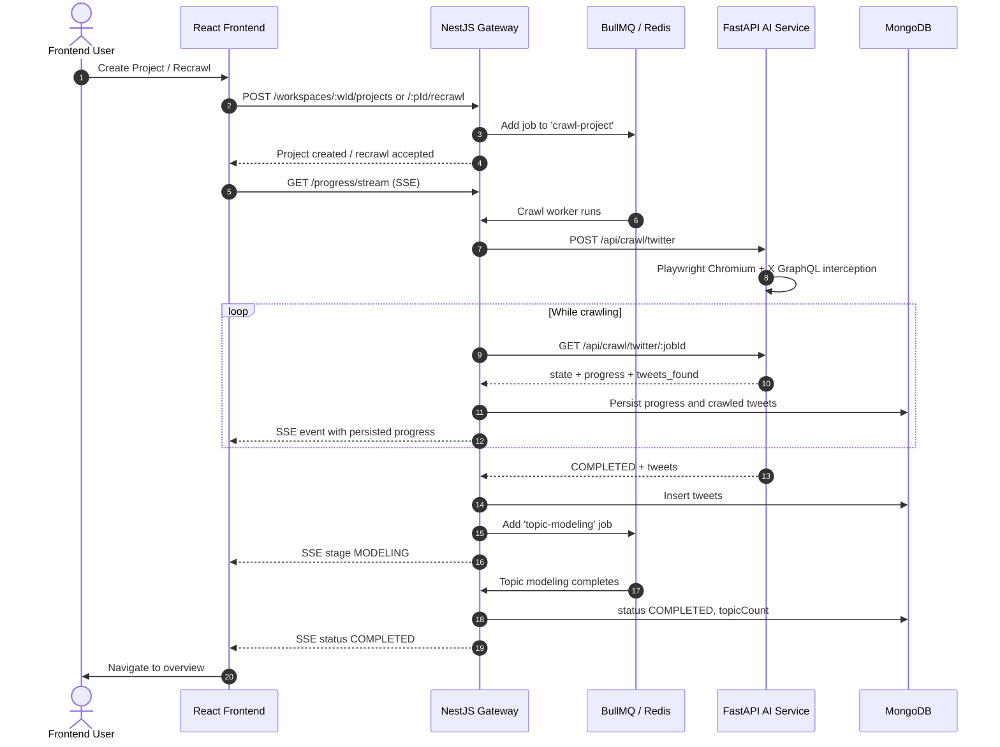

# Technical Documentation: Twitter/X Crawling Pipeline

## 1. Feature Overview

The crawling module fetches tweets from X based on project keywords and date ranges. The crawler is implemented with Playwright (Chromium) and runs inside the FastAPI AI service. NestJS queues the crawl, polls the AI job, persists tweets to MongoDB, and then chains topic modeling. The frontend follows progress through an SSE stream that reports the persisted project state.

## 2. Architecture Components

- **Frontend (`socialabs-fe`)**: Starts a crawl via `projectApi.recrawlProject()` / project creation, then follows progress with `useProjectProgress()` and `GET /workspaces/:wId/projects/:pId/progress/stream`.
- **NestJS Gateway (`socialabs-be-nest`)**:
  - `CrawlProcessor` (`crawl-project` queue): Calls the AI crawl endpoint, stores tweets, updates project progress, and queues topic modeling.
  - `ProjectController` SSE: Streams `status`, `stage`, `progress`, `crawledTweets`, `totalTweets`, and `error` read from the project document.
  - `TweetModel` (Mongoose): Stores raw tweets in the shared `tweets` collection.
- **FastAPI AI Service (`socialabs-be-ai`)**:
  - `app/domains/crawl/playwright_crawler.py`: Launches Chromium, injects the `X_AUTH_TOKEN` cookie, intercepts X GraphQL `SearchTimeline` responses while scrolling the Latest search, and returns normalized tweets.
  - `app/domains/crawl/processor.py`: BullMQ worker that runs the crawler and reports progress.
  - Crawl API: `POST /api/crawl/twitter`, `GET /api/crawl/twitter/:job_id`.

## 3. Data Flow



## 4. Data Contracts

### Crawl API (AI service)

- `POST /api/crawl/twitter` body: `{ keyword, since, until, lang, limit? }`.
  - Omit `limit` (or `null`) to fetch everything X returns; the crawler keeps a safety cap of 300 scrolls.
- `GET /api/crawl/twitter/:job_id` response data: `{ state, progress, tweets_found, tweets?, error? }`.

### NestJS Tweet Schema

```ts
export interface Tweet {
  id: string;
  projectId: string;
  tweetId: string;
  fullText: string;
  createdAtTwitter: Date;
  userIdStr: string; // screen name extracted from tweetUrl when available
  tweetUrl: string;
  quoteCount: number;
  replyCount: number;
  retweetCount: number;
  favoriteCount: number;
}
```

### SSE progress payload

```json
{
  "projectId": "…",
  "status": "CRAWLING | MODELING | COMPLETED | FAILED",
  "stage": "CRAWLING | MODELING | null",
  "progress": 0,
  "crawledTweets": 0,
  "totalTweets": 0,
  "jobId": "…",
  "error": { "stage": "CRAWLING", "message": "…" }
}
```

## 5. Troubleshooting & Notes for Developers

- **Authentication**: set `X_AUTH_TOKEN` in `socialabs-be-ai/.env` with a fresh `auth_token` cookie from an authenticated X session. `SCWEET_AUTH_TOKEN` is accepted as a legacy fallback only.
- **No results**: X returns zero results when `lang:id` is combined with date filters; the crawler normalizes `id` to `in`.
- **Username Extraction**: NestJS `CrawlProcessor` parses the screen name from `tweetUrl` with the regex `/(?:x\.com|twitter\.com)\/([^/]+)\/status/i` when `user_id_str` is not a handle.
- **SSE**: the stream reads the project document every second (keeps the connection alive at least every 15 seconds) and completes on `COMPLETED`/`FAILED`. If the stream drops, the frontend retries and then falls back to forced polling.
